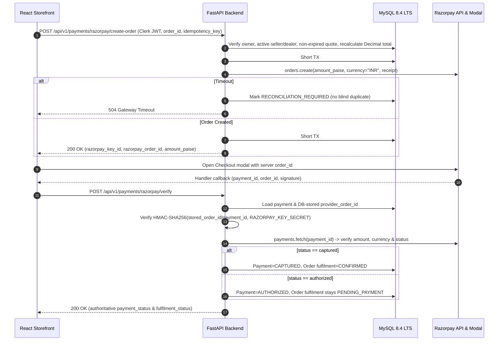
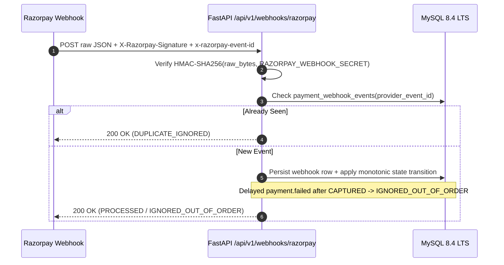
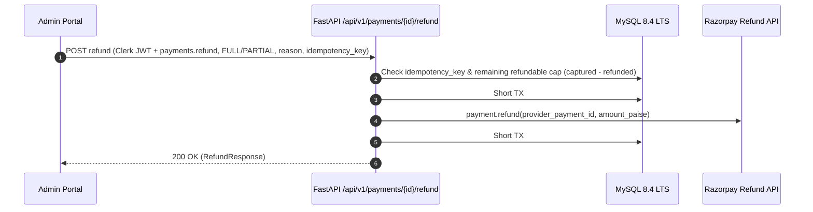

# HunarLink Razorpay Payment Flows (Mermaid Diagrams)

## 1. Retail & Wholesale Standard Checkout Flow

## 2. Server-to-Server Webhook Flow (Source of Truth for Async Events)

## 3. Admin Permissioned Refund Flow

