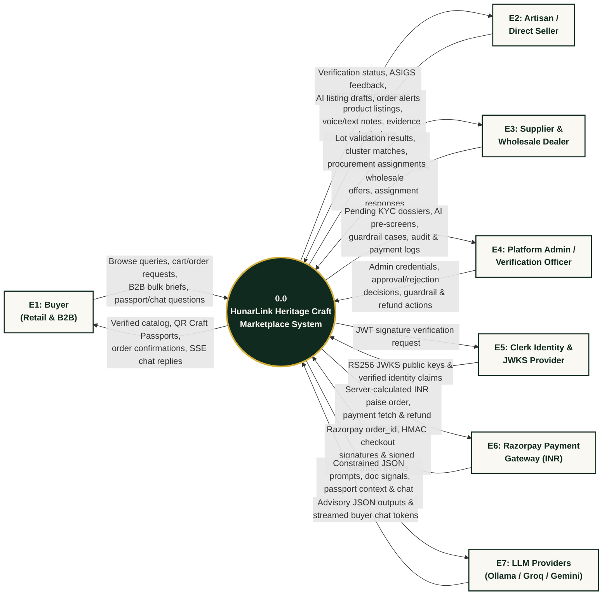

# HunarLink — DFD Level 0 (Context Diagram)

> **System:** HunarLink — GI-Verified Jammu & Kashmir Heritage Craft Marketplace  
> **Diagram Level:** Level 0 — Context Diagram (System Boundary View)  
> **Notation:** Yourdon–DeMarco / Gane–Sarson DFD Conventions  
> - **External Entities (`E1`–`E7`):** Rectangles outside the system boundary.  
> - **Central Process (`0.0`):** Single circle/node representing the entire HunarLink system.  
> - **Data Stores:** Intentionally omitted at Level 0 (data stores are internal to the system and appear in [DFD Level 1](./HUNARLINK_DFD_LEVEL_1.md)).

---

## 1. Visual Context Diagram (Mermaid)



---

## 2. Plain-Text ASCII Context Diagram

```text
  +-------------------------+                                  +-------------------------+
  | E1: Buyer (Retail/B2B)  |                                  | E5: Clerk Auth & JWKS   |
  +-------------------------+                                  +-------------------------+
     |                   ^                                        ^                   |
     | Orders, Queries,  | Catalog, QR Passports,                 | JWKS Fetch        | RS256 Public Keys
     | B2B Briefs, Chat  | Receipts, Chat Replies                 |                   | & Identity Claims
     v                   |                                        |                   v
  +-------------------------+    +------------------------+    +-------------------------+
  | E2: Artisan / Seller    |<-->|          0.0           |<-->| E6: Razorpay Gateway    |
  | (KYC, Listings, Voice)  |    |   HUNARLINK HERITAGE   |    | (Orders, HMAC, Refunds) |
  +-------------------------+    |   CRAFT MARKETPLACE    |    +-------------------------+
                                 |        SYSTEM          |
  +-------------------------+    +------------------------+    +-------------------------+
  | E3: Supplier & Dealer   |<-->|                        |<-->| E7: LLM Providers       |
  | (Lots, Wholesale Bids)  |    +------------------------+    | (Ollama / Groq / Gemini)|
  +-------------------------+       ^                  |       +-------------------------+
                                    |                  |
                          Decisions,|                  | KYC Dossiers,
                          Refunds   |                  | Guardrail Cases,
                                    |                  v Audit & Payment Logs
                                 +-------------------------+
                                 | E4: Platform Admin /    |
                                 |  Verification Officer   |
                                 +-------------------------+
```

---

## 3. External Entities & Boundary Data Flow Table

| Entity ID | External Entity | Type | Inputs Entering System (`0.0`) | Outputs Leaving System (`0.0`) |
|---|---|---|---|---|
| **E1** | **Buyer (Retail & B2B)** | Human Role | Auth JWT, search/filter queries, retail cart & shipping address, B2B bulk briefs, QR passport lookups, HunarSathi chat questions | Live verified catalog (`96` listings) & artisan profiles (`57`), QR Craft Passports, order/payment receipts, B2B cluster plans, streamed chat replies |
| **E2** | **Artisan / Direct Seller** | Human Role | Onboarding form, GI certificate / Govt Artisan Card uploads, Hinglish/Hindi/English voice/text notes, product listings, craft evidence | Upload quarantine receipts, verification status, AI pre-screen advisories, ASIGS `422` rule violations, editable listing drafts, order alerts |
| **E3** | **Supplier & Wholesale Dealer** | Human Role | Raw-material lot submissions, dealer KYC profile, wholesale listings, procurement assignment responses | Supplier/dealer guardrail validation verdicts, isolated inventory states, cluster & procurement assignments |
| **E4** | **Platform Admin / Verification Officer** | Human Role | Admin email/password credentials, Artisan approve/reject rulings, ASIGS guardrail case decisions, full/partial refund triggers | Pending KYC dossiers + AI pre-screen red flags, guardrail review queue, payment/webhook/refund ledgers, append-only audit logs |
| **E5** | **Clerk Identity & JWKS Provider** | External Service | RS256 JWKS public keys, verified user identity claims (`sub`, `email`) | Periodic JWKS fetch requests (cached) |
| **E6** | **Razorpay Payment Gateway (INR)** | External Service | `razorpay_order_id`, payment capture status, HMAC-SHA256 signatures, signed async webhooks, refund confirmations | Server-calculated `Decimal -> integer paise` order creation requests, payment fetch calls, refund requests |
| **E7** | **LLM Providers (Ollama / Groq / Gemini)** | External Service | Constrained JSON advisories (Ollama `qwen2.5:3b` / Groq / Gemini) and streamed chat tokens (Gemini Flash-Lite) | Sanitized prompts containing deterministic document signals, listing claims, passport rows, or buyer questions |

---

## 4. Context Boundary Notes

1. **Zero Data Stores at Level 0:** Per standard DFD rules, internal persistence (MySQL 8.4 LTS / SQLite tables, private upload quarantine, and Redis cache) sits inside Process `0.0` and is revealed only in **DFD Level 1**.
2. **Strict Level 0 <-> Level 1 Balancing:** Every single external entity (`E1`–`E7`) and external flow above maps 1:1 into [DFD Level 1 (`HUNARLINK_DFD_LEVEL_1.md`)](./HUNARLINK_DFD_LEVEL_1.md).
3. **Human-Controlled Trust Boundary:** External LLM providers (`E7`) only supply advisory outputs back to the system; legal verification and live artisan activation always require explicit decisions from **E4 (Platform Admin)**.
