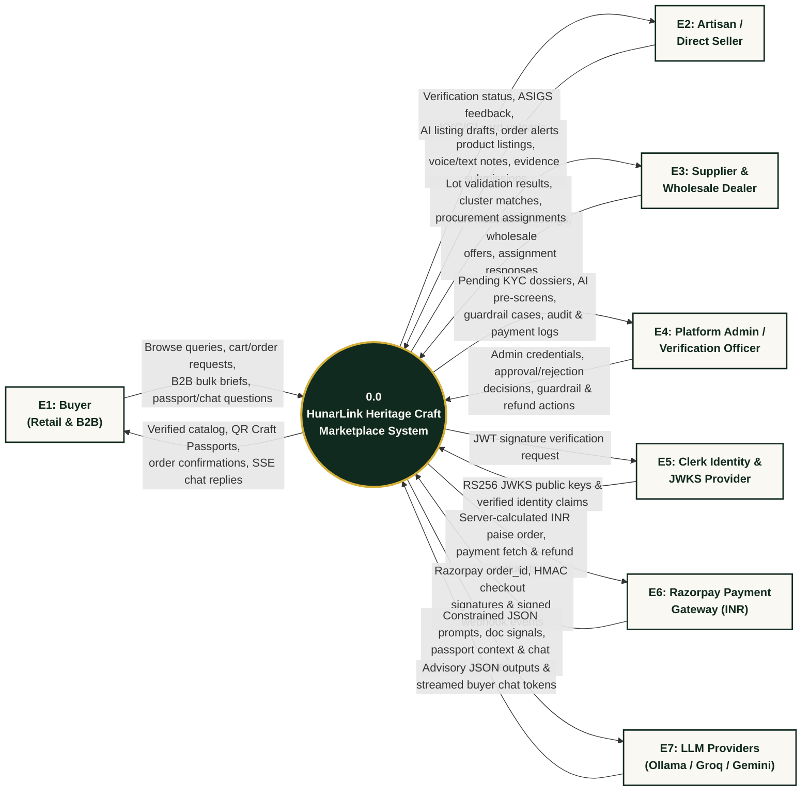

# HunarLink — Data Flow Diagrams (DFD Level 0 & Level 1)

> **System:** HunarLink — GI-Verified Jammu & Kashmir Heritage Craft Marketplace  
> **Notation:** Yourdon–DeMarco / Gane–Sarson DFD Conventions  
> - **External Entities (`E1`–`E7`):** Rectangles — sources and destinations of data outside the system boundary.  
> - **Processes (`0.0`, `1.0`–`8.0`):** Rounded nodes — transformations mapping directly to HunarLink backend/service modules.  
> - **Data Stores (`D1`–`D7`):** Cylinders (Level 1 only; omitted in Level 0 per textbook DFD balancing rules).  
> - **Data Flows:** Labeled directed arrows showing exact payloads moving across boundaries.

---

## 1. DFD Level 0 — Context Diagram

The **Context Diagram (Level 0)** views the entire HunarLink platform as a single process (`0.0`) interacting with **7 external entities**: 4 human user roles (`E1`–`E4`) and 3 external service providers (`E5`–`E7`).

### 1.1 Mermaid Diagram (Level 0)



### 1.2 Plain-Text ASCII Context Diagram (Level 0)

```text
  +-------------------------+                                  +-------------------------+
  | E1: Buyer (Retail/B2B)  |                                  | E5: Clerk Auth & JWKS   |
  +-------------------------+                                  +-------------------------+
     |                   ^                                        ^                   |
     | Orders, Queries,  | Catalog, QR Passports,                 | JWKS Fetch        | RS256 Public Keys
     | B2B Briefs, Chat  | Receipts, Chat Replies                 |                   | & Identity Claims
     v                   |                                        |                   v
  +-------------------------+    +------------------------+    +-------------------------+
  | E2: Artisan / Seller    |<-->|          0.0           |<-->| E6: Razorpay Gateway    |
  | (KYC, Listings, Voice)  |    |   HUNARLINK HERITAGE   |    | (Orders, HMAC, Refunds) |
  +-------------------------+    |   CRAFT MARKETPLACE    |    +-------------------------+
                                 |        SYSTEM          |
  +-------------------------+    +------------------------+    +-------------------------+
  | E3: Supplier & Dealer   |<-->|                        |<-->| E7: LLM Providers       |
  | (Lots, Wholesale Bids)  |    +------------------------+    | (Ollama / Groq / Gemini)|
  +-------------------------+       ^                  |       +-------------------------+
                                    |                  |
                          Decisions,|                  | KYC Dossiers,
                          Refunds   |                  | Guardrail Cases,
                                    |                  v Audit & Payment Logs
                                 +-------------------------+
                                 | E4: Platform Admin /    |
                                 |  Verification Officer   |
                                 +-------------------------+
```

### 1.3 Level 0 External Entity & Boundary Flow Summary

| ID | External Entity | Key Inputs to System (`0.0`) | Key Outputs from System (`0.0`) |
|---|---|---|---|
| **E1** | **Buyer (Retail & B2B)** | Login credentials, search/filter queries, retail cart & shipping details, B2B bulk briefs, QR passport lookups, HunarSathi chat questions | Live verified catalog & artisan stories, CraftProof QR Passports, order & payment receipts, B2B cluster match proposals, streamed chat answers |
| **E2** | **Artisan / Direct Seller** | Onboarding form, GI certificate / Govt Artisan Card uploads, Hinglish/Hindi/English voice/text notes, product listings, craft evidence | File quarantine receipts, verification status, AI pre-screen advisories, ASIGS rule violations (`422`), listing drafts, order notifications |
| **E3** | **Supplier & Wholesale Dealer** | Raw-material lot submissions, dealer KYC profile, wholesale listings, procurement assignment accept/reject actions | Supplier/dealer guardrail validation reports, isolated inventory status, procurement & cluster assignments |
| **E4** | **Platform Admin / Officer** | Admin email/password login, Artisan approval/rejection decisions, ASIGS guardrail case rulings, full/partial refund triggers | Staged KYC dossiers + AI pre-screen flags, guardrail review queue, payment/webhook/refund tables, append-only audit logs |
| **E5** | **Clerk Identity & JWKS** | RS256 JWKS public key set, OAuth/OTP/Email session JWTs | Periodic JWKS fetch requests (cached) |
| **E6** | **Razorpay Payment Gateway** | Checkout `order_id`, payment status fetch, HMAC-SHA256 signatures, asynchronous signed webhook payloads, refund confirmations | Server-calculated `Decimal -> paise` order creation requests, refund API requests |
| **E7** | **LLM Providers** | Constrained JSON advisories (Ollama `qwen2.5:3b` / Groq / Gemini), streamed buyer chat tokens (Gemini Flash-Lite) | Sanitized prompts with deterministic doc signals, listing claims, passport evidence rows, or buyer queries |

---

## 2. DFD Level 1 — System Decomposition Diagram

Level 1 decomposes Process `0.0` into **8 cohesive sub-processes (`1.0`–`8.0`)** backed by **7 logical data stores (`D1`–`D7`)**, preserving strict input/output balancing with Level 0.

### 2.1 Mermaid Diagram (Level 1)

```mermaid
flowchart TB
    %% Styling
    classDef entity fill:#FAF8F2,stroke:#112A20,stroke-width:2px,color:#112A20,font-weight:bold
    classDef proc fill:#16382B,stroke:#D4AF37,stroke-width:2px,color:#FAF8F2,font-weight:bold
    classDef store fill:#F3EFE4,stroke:#9A3412,stroke-width:2px,color:#112A20

    %% External Entities (Balanced with Level 0)
    E1["E1: Buyer (Retail & B2B)"]:::entity
    E2["E2: Artisan / Direct Seller"]:::entity
    E3["E3: Supplier & Dealer"]:::entity
    E4["E4: Platform Admin"]:::entity
    E5["E5: Clerk JWKS"]:::entity
    E6["E6: Razorpay Gateway"]:::entity
    E7["E7: LLM Providers<br/>(Ollama / Groq / Gemini)"]:::entity

    %% Core Sub-Processes (1.0 - 8.0)
    P1("1.0<br/>Identity, Auth &<br/>RBAC Management"):::proc
    P2("2.0<br/>Artisan Onboarding &<br/>Document Quarantine"):::proc
    P3("3.0<br/>ASIGS 10-Layer Guardrails<br/>& Admin Moderation"):::proc
    P4("4.0<br/>Storefront Catalog, Cart<br/>& Retail Orders"):::proc
    P5("5.0<br/>Razorpay Payments,<br/>Verification & Refunds"):::proc
    P6("6.0<br/>CraftProof Passports &<br/>Advisory AI Engine"):::proc
    P7("7.0<br/>B2B Demand Bridge &<br/>Supply Procurement"):::proc
    P8("8.0<br/>HunarSathi Streaming<br/>Buyer Assistant"):::proc

    %% Data Stores (D1 - D7)
    D1[("D1: Identity, Accounts<br/>& RBAC Tables")]:::store
    D2[("D2: Seller Profiles,<br/>KYC Docs & GI Registry")]:::store
    D3[("D3: Guardrail Cases,<br/>Rules & Audit Logs")]:::store
    D4[("D4: Catalog, Listings<br/>& Orders Store")]:::store
    D5[("D5: Payments, Webhooks<br/>& Refunds Store")]:::store
    D6[("D6: Craft Passports, Claims,<br/>Capabilities & B2B Store")]:::store
    D7[("D7: Redis Cache, ZSET Rate<br/>Limits & Revoked jti")]:::store

    %% --- Process 1.0: Auth & RBAC ---
    E1 & E2 & E3 -->|"Bearer Clerk JWT / auth sync"| P1
    E4 -->|"Admin email + password / logout"| P1
    P1 <-->|"Fetch RS256 JWKS / verify JWT"| E5
    P1 <-->|"Enforce 1-role-per-email & PBKDF2/RBAC"| D1
    P1 <-->|"Check/store revoked Admin jti & rate limits"| D7
    P1 -->|"Auth principal & role claims"| P2 & P3 & P4 & P5 & P6 & P7

    %% --- Process 2.0: Artisan Onboarding & Quarantine ---
    E2 -->|"KYC form + GI/Artisan Card PDF/Image"| P2
    P2 -->|"Magic-byte, SHA-256 & EICAR scan -> DRAFT stage"| D2
    P2 -->|"File scan ID + extracted PDF signals"| P6
    P2 -->|"Onboarding audit event"| D3
    P2 -->|"Submission receipt & DRAFT status"| E2

    %% --- Process 3.0: ASIGS Guardrails & Admin Moderation ---
    E2 -->|"Listing submission for 10-layer validation"| P3
    E3 -->|"Supplier lot / Dealer profile validation"| P3
    E4 -->|"Approve/Reject artisan or guardrail ruling"| P3
    P3 <-->|"Read staged KYC + promote APPROVED/ACTIVE"| D2
    P3 <-->|"Log guardrail cases, violations & audit trail"| D3
    P3 -->|"Bump domain cache version (INCR hl:ver:*)"| D7
    P3 -->|"Validation verdict (422 violations / OK)"| E2 & E3
    P3 -->|"KYC queue, AI flags & case history"| E4

    %% --- Process 4.0: Storefront Catalog & Retail Orders ---
    E1 -->|"Search catalog, view artisan, submit retail order"| P4
    P4 <-->|"Read/write active listings & retail orders"| D4
    P4 <-->|"Read-through cache & stampede lock"| D7
    P4 -->|"Verified catalog, artisan pages & order_id"| E1
    P4 -->|"Authoritative DB order reference"| P5

    %% --- Process 5.0: Razorpay Payments & Refunds ---
    E1 -->|"Create payment order / submit Razorpay signature"| P5
    E4 -->|"Initiate full/partial refund"| P5
    P5 <-->|"Read authoritative DB prices / update order PAID"| D4
    P5 <-->|"Create INR paise order, fetch capture, refund"| E6
    E6 -->|"Signed async webhook (raw-body HMAC)"| P5
    P5 <-->|"Store payment ledger, webhook idempotency & refunds"| D5
    P5 -->|"Payment/refund audit record"| D3
    P5 -->|"Verified payment receipt / refund status"| E1 & E4

    %% --- Process 6.0: CraftProof Passports & Advisory AI ---
    E1 -->|"Scan QR / ask evidence-locked passport question"| P6
    E2 -->|"Voice/text copilot draft & craft-economics audit"| P6
    P6 <-->|"Read/write passports, claims, events & QR SVG"| D6
    P6 <-->|"Cross-check GI registry & persist AI pre-screen"| D2
    P6 <-->|"Constrained JSON prompts (fallback rules-v1)"| E7
    P6 -->|"Log ai_interaction_logs (is_legal_proof=0)"| D3
    P6 -->|"QR Passport & evidence-locked answers"| E1
    P6 -->|"Editable drafts, risk flags & Fair-Craft split"| E2

    %% --- Process 7.0: B2B Demand Bridge & Procurement ---
    E1 -->|"Submit B2B bulk hospitality/corporate brief"| P7
    E3 -->|"Respond to procurement / cluster assignments"| P7
    P7 <-->|"Match artisan capacities, clusters & supplier lots"| D6
    P7 <-->|"Read wholesale listings & orders"| D4
    P7 -->|"Cluster fulfillment plan & timeline"| E1 & E3

    %% --- Process 8.0: HunarSathi Buyer Chatbot ---
    E1 -->|"Natural-language craft/policy chat query"| P8
    P8 <-->|"Stream tokens (Gemini Flash-Lite failover)"| E7
    P8 -->|"SSE streamed craft reply (or safety refusal)"| E1
```



---

## 3. Level 1 Process Specifications (Mapped to Codebase)

| Process | Name | Primary Inputs | Core Transformation / Business Rules | Primary Outputs | Codebase Modules |
|---|---|---|---|---|---|
| **1.0** | **Identity, Auth & RBAC Management** | Clerk RS256 Bearer JWT (`E1`–`E3`), Admin credentials (`E4`), JWKS keys (`E5`) | Verifies Clerk RS256 signatures; verifies Admin PBKDF2-HMAC-SHA256 hashes & HS256 JWTs; enforces strict **1-role-per-email isolation** across `buyer_accounts`, `artisan_accounts`, `admin_accounts`; checks Redis/local revoked `jti` & rate limits (`D7`). | Authenticated principal & RBAC scopes (`401`/`403`/`404`/`409`/`429` on rejection) | `backend/app/core/auth.py`, `admin_security.py`, `account_tables.py`, `modules/auth/` |
| **2.0** | **Artisan Onboarding & Document Quarantine** | Artisan application form + GI/Govt Card file (`E2`) | Checks magic bytes (JPG/PNG/WebP/PDF), `<5 MB` size cap, SHA-256 digest, EICAR malware signature; stores file outside webroot (`D2`); stages profile as `DRAFT/SUBMITTED` (invisible to public storefront); extracts PDF text via `pypdf`. | `FileSecurityScan` record, staged `SellerVerificationApplication`, doc signals for Process `6.0` | `backend/app/modules/auth/router.py`, `modules/guardrails/providers/malware_scanner.py`, `modules/ai/doc_extractor.py` |
| **3.0** | **ASIGS 10-Layer Guardrails & Admin Moderation** | Seller listings (`E2`), Supplier lots & Dealer profiles (`E3`), Admin rulings (`E4`) | Runs 10-layer ASIGS rules: contraband/Shahtoosh safety block, GI vs Non-GI claim gating, commercial/inventory isolation, duplicate escalation, ownership/state machines. Only human Admin with `guardrails.decide` promotes sellers to `APPROVED/ACTIVE` and bumps Redis namespace versions. | Structured `422` violation arrays, approved live artisan/listing states, append-only `audit_logs` (`D3`) | `backend/app/modules/guardrails/` (`service.py`, `rules/`), `modules/storefront/router.py` (Admin endpoints) |
| **4.0** | **Storefront Catalog, Cart & Retail Orders** | Buyer browse/filter queries, product/artisan UUID requests, retail checkout cart (`E1`) | Serves verified active artisans (`57`) & approved listings (`96`) via Redis read-through cache (`D7`) with automatic DB fallback; creates server-authoritative retail orders in `D4` (strictly separating `COD` from `RAZORPAY_STANDARD`). | Catalog JSON, artisan showcase pages, authoritative `retail_orders` row | `backend/app/modules/storefront/` (`router.py`, `service.py`), `core/cache.py` |
| **5.0** | **Razorpay Payments, Verification & Refunds** | Order ID & Razorpay callback signature (`E1`), Admin refund request (`E4`), Signed webhooks (`E6`) | Re-fetches order prices from `D4` in exact `Decimal` -> converts to integer **paise** (never trusts client totals); calls Razorpay SDK (`E6`); verifies checkout & raw-body webhook signatures via constant-time **HMAC-SHA256**; enforces idempotent replay; executes RBAC-gated refunds. | Captured payment records (`D5`), `PAID` order state (`D4`), refund receipts, audit logs (`D3`) | `backend/app/modules/payments/`, `integrations/razorpay/` (`client.py`, `signatures.py`, `schemas.py`) |
| **6.0** | **CraftProof Passports & Advisory AI Engine** | Doc signals (`2.0`), voice/text draft notes & listing audit requests (`E2`), QR passport & buyer Q&A (`E1`) | **Pillar 1A** doc cross-check vs `gi_reference_records`; **Pillar 1B** craft-economics fraud math (price/stock/labor floors); **Pillar 2** Hinglish Voice-to-Passport Copilot + Fair-Craft breakdown; **Pillar 3** Refuses-to-Lie evidence-locked Q&A; pure-Python QR SVG (`segno`). Calls Ollama/Groq/Gemini (`E7`) with deterministic `rules-v1` fallback. | QR Craft Passports (`D6`), `SELLER_DECLARED` atomic claims, advisory dossiers, `ai_interaction_logs` (`D3`) | `backend/app/modules/craftproof/`, `backend/app/modules/ai/` (`provider.py`, `service.py`) |
| **7.0** | **B2B Demand Bridge & Supply Procurement** | Bulk corporate/hospitality demand briefs (`E1`), Supplier lots & Dealer responses (`E3`) | Parses bulk order specs (craft guild, quantity, deadline, budget), matches against `artisan_capabilities` in `D6`, computes multi-artisan cluster pooling splits, and tracks supplier-to-dealer procurement separately from retail checkout. | Multi-artisan cluster match plan, procurement assignments, wholesale records | `backend/app/modules/demand_bridge/` (`matcher.py`, `router.py`), `modules/guardrails/` |
| **8.0** | **HunarSathi Streaming Buyer Assistant** | Buyer conversational questions (`E1`) | Applies contraband & off-topic safety guardrails, per-IP sliding-window rate limits, bounded LRU session memory, and TTL response caching; streams tokens over SSE using Gemini Flash-Lite failover ladder (`E7`) with local knowledge-base fallback. | Server-Sent Events (`POST /api/chat/stream`) or JSON reply to buyer widget | `hunarsathi-chatbot/` (`server.py`, `chatbot.py`, `knowledge_base.py`) |

---

## 4. Data Store Dictionary (`D1`–`D7`)

| Store ID | Logical Data Store | Physical Implementation & Representative Tables |
|---|---|---|
| **D1** | **Identity, Accounts & RBAC Store** | MySQL 8.4 LTS (SQLite local dev): `users`, `buyer_accounts`, `artisan_accounts`, `admin_accounts`, `platform_roles`, `user_role_assignments`, `admin_credentials` |
| **D2** | **Seller Profiles, KYC Docs & GI Registry** | MySQL/SQLite + Private Disk Quarantine (`./var/private_uploads`): `seller_profiles`, `seller_verification_applications`, `seller_documents`, `file_security_scans`, `gi_reference_records` |
| **D3** | **Guardrail Cases, Rules & Audit Store** | MySQL/SQLite (append-only governance): `guardrail_cases`, `guardrail_rule_definitions`, `guardrail_case_decisions`, `audit_logs`, `ai_interaction_logs` |
| **D4** | **Catalog, Listings & Orders Store** | MySQL/SQLite: `categories`, `products`, `product_images`, `seller_product_listings`, `retail_orders`, `retail_order_items`, `wholesale_orders` |
| **D5** | **Payments, Webhooks & Refunds Store** | MySQL/SQLite: `payments`, `payment_attempts`, `payment_webhook_events`, `payment_refunds` |
| **D6** | **CraftPassports, Claims & B2B Capacity Store** | MySQL/SQLite: `craft_passports`, `craft_claims`, `craft_evidence_items`, `craft_verification_events`, `artisan_capabilities`, `b2b_demand_requests`, `supplier_lots` |
| **D7** | **Redis Cache, Rate-Limit & Session Store** | Redis 8 (`app/core/redis_client.py` + `cache.py`) with 15-second circuit breaker & automatic in-memory/DB fallback: `hl:cache:*`, `hl:ver:{domain}`, ZSET rate-limit keys, revoked Admin `jti` keys |

---

## 5. Key Architectural & Security Invariants Across Data Flows

1. **Strict Balancing (Level 0 = Level 1):** Every external entity (`E1`–`E7`) and boundary data flow shown in Level 0 enters and exits cleanly in Level 1 without black-hole processes or miracle outputs.
2. **Database-Enforced AI Trust Boundary (`P6 -> D3/D6`):** SQL `CHECK` constraints (`chk_cve_ai_never_verifies`, `chk_ail_not_legal_proof`) physically prevent Process `6.0` from ever setting `HUMAN_VERIFIED` or `is_legal_proof = 1`.
3. **Server-Authoritative Money Flow (`P4 -> P5 -> E6`):** Client browsers never dictate payment totals; Process `5.0` recomputes every rupee from `D4` in `Decimal` and converts to integer paise before calling `E6`.
4. **Prohibited Contraband Pre-Filter (`P2`, `P3`, `P6`, `P8`):** Weapons, narcotics, and **Shahtoosh** wildlife contraband are blocked deterministically **before** reaching any external LLM (`E7`) or catalog store (`D4`).
5. **Graceful Degradation (`D7`):** If Redis (`D7`) is unavailable, the 15-second circuit breaker degrades caching, rate limiting, and `jti` checks cleanly to MySQL/SQLite and bounded in-process state without breaking availability.
