# HunarLink — DFD Level 1 (System Decomposition Diagram)

> **System:** HunarLink — GI-Verified Jammu & Kashmir Heritage Craft Marketplace  
> **Diagram Level:** Level 1 — Sub-Process & Data Store Decomposition (Balanced with [DFD Level 0](./HUNARLINK_DFD_LEVEL_0.md))  
> **Notation:** Yourdon–DeMarco / Gane–Sarson DFD Conventions  
> - **External Entities (`E1`–`E7`):** Identical to Level 0 (strict balancing preserved).  
> - **Sub-Processes (`1.0`–`8.0`):** 8 cohesive modules decomposing Process `0.0`.  
> - **Data Stores (`D1`–`D7`):** Logical persistence stores mapped to MySQL/SQLite tables, quarantined file storage, and Redis.

---

## 1. Visual System Decomposition Diagram (Mermaid)

```mermaid
flowchart TB
    %% Styling
    classDef entity fill:#FAF8F2,stroke:#112A20,stroke-width:2px,color:#112A20,font-weight:bold
    classDef proc fill:#16382B,stroke:#D4AF37,stroke-width:2px,color:#FAF8F2,font-weight:bold
    classDef store fill:#F3EFE4,stroke:#9A3412,stroke-width:2px,color:#112A20

    %% External Entities (Balanced with Level 0)
    E1["E1: Buyer (Retail & B2B)"]:::entity
    E2["E2: Artisan / Direct Seller"]:::entity
    E3["E3: Supplier & Dealer"]:::entity
    E4["E4: Platform Admin"]:::entity
    E5["E5: Clerk JWKS"]:::entity
    E6["E6: Razorpay Gateway"]:::entity
    E7["E7: LLM Providers<br/>(Ollama / Groq / Gemini)"]:::entity

    %% Core Sub-Processes (1.0 - 8.0)
    P1("1.0<br/>Identity, Auth &<br/>RBAC Management"):::proc
    P2("2.0<br/>Artisan Onboarding &<br/>Document Quarantine"):::proc
    P3("3.0<br/>ASIGS 10-Layer Guardrails<br/>& Admin Moderation"):::proc
    P4("4.0<br/>Storefront Catalog, Cart<br/>& Retail Orders"):::proc
    P5("5.0<br/>Razorpay Payments,<br/>Verification & Refunds"):::proc
    P6("6.0<br/>CraftProof Passports &<br/>Advisory AI Engine"):::proc
    P7("7.0<br/>B2B Demand Bridge &<br/>Supply Procurement"):::proc
    P8("8.0<br/>HunarSathi Streaming<br/>Buyer Assistant"):::proc

    %% Data Stores (D1 - D7)
    D1[("D1: Identity, Accounts<br/>& RBAC Tables")]:::store
    D2[("D2: Seller Profiles,<br/>KYC Docs & GI Registry")]:::store
    D3[("D3: Guardrail Cases,<br/>Rules & Audit Logs")]:::store
    D4[("D4: Catalog, Listings<br/>& Orders Store")]:::store
    D5[("D5: Payments, Webhooks<br/>& Refunds Store")]:::store
    D6[("D6: Craft Passports, Claims,<br/>Capabilities & B2B Store")]:::store
    D7[("D7: Redis Cache, ZSET Rate<br/>Limits & Revoked jti")]:::store

    %% --- Process 1.0: Auth & RBAC ---
    E1 & E2 & E3 -->|"Bearer Clerk JWT / auth sync"| P1
    E4 -->|"Admin email + password / logout"| P1
    P1 <-->|"Fetch RS256 JWKS / verify JWT"| E5
    P1 <-->|"Enforce 1-role-per-email & PBKDF2/RBAC"| D1
    P1 <-->|"Check/store revoked Admin jti & rate limits"| D7
    P1 -->|"Auth principal & role claims"| P2 & P3 & P4 & P5 & P6 & P7

    %% --- Process 2.0: Artisan Onboarding & Quarantine ---
    E2 -->|"KYC form + GI/Artisan Card PDF/Image"| P2
    P2 -->|"Magic-byte, SHA-256 & EICAR scan -> DRAFT stage"| D2
    P2 -->|"File scan ID + extracted PDF signals"| P6
    P2 -->|"Onboarding audit event"| D3
    P2 -->|"Submission receipt & DRAFT status"| E2

    %% --- Process 3.0: ASIGS Guardrails & Admin Moderation ---
    E2 -->|"Listing submission for 10-layer validation"| P3
    E3 -->|"Supplier lot / Dealer profile validation"| P3
    E4 -->|"Approve/Reject artisan or guardrail ruling"| P3
    P3 <-->|"Read staged KYC + promote APPROVED/ACTIVE"| D2
    P3 <-->|"Log guardrail cases, violations & audit trail"| D3
    P3 -->|"Bump domain cache version (INCR hl:ver:*)"| D7
    P3 -->|"Validation verdict (422 violations / OK)"| E2 & E3
    P3 -->|"KYC queue, AI flags & case history"| E4

    %% --- Process 4.0: Storefront Catalog & Retail Orders ---
    E1 -->|"Search catalog, view artisan, submit retail order"| P4
    P4 <-->|"Read/write active listings & retail orders"| D4
    P4 <-->|"Read-through cache & stampede lock"| D7
    P4 -->|"Verified catalog, artisan pages & order_id"| E1
    P4 -->|"Authoritative DB order reference"| P5

    %% --- Process 5.0: Razorpay Payments & Refunds ---
    E1 -->|"Create payment order / submit Razorpay signature"| P5
    E4 -->|"Initiate full/partial refund"| P5
    P5 <-->|"Read authoritative DB prices / update order PAID"| D4
    P5 <-->|"Create INR paise order, fetch capture, refund"| E6
    E6 -->|"Signed async webhook (raw-body HMAC)"| P5
    P5 <-->|"Store payment ledger, webhook idempotency & refunds"| D5
    P5 -->|"Payment/refund audit record"| D3
    P5 -->|"Verified payment receipt / refund status"| E1 & E4

    %% --- Process 6.0: CraftProof Passports & Advisory AI ---
    E1 -->|"Scan QR / ask evidence-locked passport question"| P6
    E2 -->|"Voice/text copilot draft & craft-economics audit"| P6
    P6 <-->|"Read/write passports, claims, events & QR SVG"| D6
    P6 <-->|"Cross-check GI registry & persist AI pre-screen"| D2
    P6 <-->|"Constrained JSON prompts (fallback rules-v1)"| E7
    P6 -->|"Log ai_interaction_logs (is_legal_proof=0)"| D3
    P6 -->|"QR Passport & evidence-locked answers"| E1
    P6 -->|"Editable drafts, risk flags & Fair-Craft split"| E2

    %% --- Process 7.0: B2B Demand Bridge & Procurement ---
    E1 -->|"Submit B2B bulk hospitality/corporate brief"| P7
    E3 -->|"Respond to procurement / cluster assignments"| P7
    P7 <-->|"Match artisan capacities, clusters & supplier lots"| D6
    P7 <-->|"Read wholesale listings & orders"| D4
    P7 -->|"Cluster fulfillment plan & timeline"| E1 & E3

    %% --- Process 8.0: HunarSathi Buyer Chatbot ---
    E1 -->|"Natural-language craft/policy chat query"| P8
    P8 <-->|"Stream tokens (Gemini Flash-Lite failover)"| E7
    P8 -->|"SSE streamed craft reply (or safety refusal)"| E1
```

---

## 2. Sub-Process Specifications (`1.0`–`8.0`) Mapped to Codebase

| Process | Name | Inputs | Core Processing & Business Rules | Outputs | Codebase Files |
|---|---|---|---|---|---|
| **1.0** | **Identity, Auth & RBAC Management** | Clerk RS256 Bearer JWT (`E1`–`E3`), Admin credentials (`E4`), JWKS keys (`E5`) | Verifies Clerk RS256 JWTs; verifies Admin PBKDF2-HMAC-SHA256 passwords & HS256 JWTs; enforces strict **1-role-per-email isolation** across `buyer_accounts`, `artisan_accounts`, and `admin_accounts`; checks Redis/local revoked `jti` & ZSET rate limits (`D7`). | Authenticated principal & RBAC scopes (`401`/`403`/`404`/`409`/`429` on denial) | `backend/app/core/auth.py`, `admin_security.py`, `account_tables.py`, `modules/auth/` |
| **2.0** | **Artisan Onboarding & Document Quarantine** | KYC form + GI / Govt Artisan Card PDF/Image (`E2`), Auth principal (`1.0`) | Inspects file magic bytes (JPG/PNG/WebP/PDF), `<5 MB` size cap, SHA-256 digest, EICAR malware signature; saves outside webroot (`D2`); stages profile as `DRAFT/SUBMITTED` (hidden from storefront); extracts embedded PDF text via `pypdf`. | `FileSecurityScan` row, staged `SellerVerificationApplication`, doc signals to `6.0`, audit log (`D3`) | `backend/app/modules/auth/router.py`, `modules/guardrails/providers/malware_scanner.py`, `modules/ai/doc_extractor.py` |
| **3.0** | **ASIGS 10-Layer Guardrails & Admin Moderation** | Seller listings (`E2`), Supplier lots & Dealer KYC (`E3`), Admin rulings (`E4`) | Executes 10-layer ASIGS validation: contraband/Shahtoosh safety block, GI vs Non-GI verification gating, commercial/inventory isolation, duplicate escalation, ownership/state machines. Only human Admin (`guardrails.decide`) promotes sellers to `APPROVED/ACTIVE` and bumps Redis namespace versions (`INCR hl:ver:*`). | Structured `422` violations or approval, updated `D2`, append-only `audit_logs` (`D3`) | `backend/app/modules/guardrails/` (`service.py`, `rules/`), `modules/storefront/router.py` |
| **4.0** | **Storefront Catalog, Cart & Retail Orders** | Search/filter queries, artisan UUID lookups, retail checkout cart (`E1`) | Serves verified active artisans (`57`) & approved listings (`96`) using Redis read-through caching + stampede lock (`D7`) with automatic DB fallback; creates server-authoritative retail orders in `D4` (isolating `COD` from `RAZORPAY_STANDARD`). | Catalog JSON, artisan pages, authoritative `retail_orders` row to `E1` & `5.0` | `backend/app/modules/storefront/` (`router.py`, `service.py`), `core/cache.py` |
| **5.0** | **Razorpay Payments, Verification & Refunds** | Order ID & Razorpay callback signature (`E1`), Admin refund request (`E4`), Signed webhook (`E6`) | Re-fetches prices from `D4` in exact `Decimal` -> converts to integer **paise** (never trusts browser totals); creates Razorpay order (`E6`); verifies checkout & raw-body webhooks with constant-time **HMAC-SHA256**; enforces idempotency; processes RBAC-gated refunds. | Captured payments (`D5`), `PAID` order status (`D4`), refund receipts, audit logs (`D3`) | `backend/app/modules/payments/`, `integrations/razorpay/` (`client.py`, `signatures.py`, `schemas.py`) |
| **6.0** | **CraftProof Passports & Advisory AI Engine** | Doc signals (`2.0`), voice/text copilot & audit payloads (`E2`), QR passport & Q&A (`E1`) | **Pillar 1A** doc cross-check vs `gi_reference_records`; **Pillar 1B** craft-economics fraud math (price/stock/labor floors); **Pillar 2** Hinglish Voice-to-Passport Copilot + Fair-Craft split; **Pillar 3** Refuses-to-Lie evidence-locked Q&A; QR SVG (`segno`). Calls Ollama/Groq/Gemini (`E7`) with deterministic `rules-v1` fallback. | QR Passports (`D6`), `SELLER_DECLARED` claims, advisory dossiers (`D2`), `ai_interaction_logs` (`D3`) | `backend/app/modules/craftproof/`, `backend/app/modules/ai/` (`provider.py`, `service.py`) |
| **7.0** | **B2B Demand Bridge & Supply Procurement** | Bulk hospitality/corporate briefs (`E1`), Supplier/Dealer responses (`E3`) | Parses bulk order briefs (guild, qty, deadline, budget), matches against `artisan_capabilities` (`D6`), computes multi-artisan cluster pooling splits, and keeps supplier-to-dealer procurement strictly isolated from retail checkout. | Multi-artisan cluster fulfillment plan & timeline (`E1`, `E3`) | `backend/app/modules/demand_bridge/` (`matcher.py`, `router.py`), `modules/guardrails/` |
| **8.0** | **HunarSathi Streaming Buyer Assistant** | Natural-language craft/policy buyer questions (`E1`) | Enforces contraband & off-topic guardrails, per-IP sliding-window rate limits, bounded LRU session memory, and TTL cache; streams SSE tokens via Gemini Flash-Lite failover ladder (`E7`) with local knowledge-base fallback. | Streamed SSE (`POST /api/chat/stream`) or JSON buyer replies | `hunarsathi-chatbot/` (`server.py`, `chatbot.py`, `knowledge_base.py`) |

---

## 3. Logical Data Store Dictionary (`D1`–`D7`)

| Store ID | Logical Data Store | Physical Implementation & Representative Tables |
|---|---|---|
| **D1** | **Identity, Accounts & RBAC Store** | MySQL 8.4 LTS (SQLite local dev): `users`, `buyer_accounts`, `artisan_accounts`, `admin_accounts`, `platform_roles`, `user_role_assignments`, `admin_credentials` |
| **D2** | **Seller Profiles, KYC Docs & GI Registry** | MySQL/SQLite + Private Disk Quarantine (`./var/private_uploads`): `seller_profiles`, `seller_verification_applications`, `seller_documents`, `file_security_scans`, `gi_reference_records` |
| **D3** | **Guardrail Cases, Rules & Audit Store** | MySQL/SQLite (append-only governance): `guardrail_cases`, `guardrail_rule_definitions`, `guardrail_case_decisions`, `audit_logs`, `ai_interaction_logs` |
| **D4** | **Catalog, Listings & Orders Store** | MySQL/SQLite: `categories`, `products`, `product_images`, `seller_product_listings`, `retail_orders`, `retail_order_items`, `wholesale_orders` |
| **D5** | **Payments, Webhooks & Refunds Store** | MySQL/SQLite: `payments`, `payment_attempts`, `payment_webhook_events`, `payment_refunds` |
| **D6** | **CraftPassports, Claims & B2B Capacity Store** | MySQL/SQLite: `craft_passports`, `craft_claims`, `craft_evidence_items`, `craft_verification_events`, `artisan_capabilities`, `b2b_demand_requests`, `supplier_lots` |
| **D7** | **Redis Cache, Rate-Limit & Session Store** | Redis 8 (`app/core/redis_client.py`, `cache.py`) with 15s circuit breaker & automatic DB/in-memory fallback: `hl:cache:*`, `hl:ver:{domain}`, ZSET rate-limit windows, revoked Admin `jti` keys |

---

## 4. Balancing & Security Invariants

1. **Level 0 <-> Level 1 Balancing Verified:** All 7 external entities (`E1`–`E7`) and every external boundary flow in [DFD Level 0](./HUNARLINK_DFD_LEVEL_0.md) match Level 1 identically with zero orphan stores or ungrounded processes.
2. **DB-Enforced AI Trust Boundary (`6.0 -> D3/D6`):** SQL `CHECK` constraints (`chk_cve_ai_never_verifies`, `chk_ail_not_legal_proof`) physically block AI outputs from ever marking a claim `HUMAN_VERIFIED` or `is_legal_proof = 1`.
3. **Server-Authoritative Pricing (`4.0 -> 5.0 -> E6`):** Browser totals are ignored; Process `5.0` recalculates exact `Decimal` INR totals from `D4` and converts to integer paise before invoking Razorpay (`E6`).
4. **Pre-LLM Contraband Filter (`2.0`, `3.0`, `6.0`, `8.0`):** Weapons, narcotics, and **Shahtoosh** wildlife contraband are blocked deterministically before any prompt is sent to `E7` or stored in `D4`.
5. **Graceful Circuit-Breaker Fallback (`D7`):** If Redis is offline, caching, ZSET rate limiting, and Admin `jti` revocation automatically fall back to DB + bounded in-process state while keeping `/readyz` healthy.
