# HunarLink — MySQL 8.4 LTS Database Architecture & ERD

## 1. Core Design Decisions (Plain Language)

| Rule | Choice in HunarLink MySQL | Why It Matters |
|---|---|---|
| **Storage Engine** | `InnoDB` on every table | Supports ACID transactions, row locks (`SELECT ... FOR UPDATE`), and foreign keys. |
| **Character Set & Collation** | `utf8mb4` / `utf8mb4_0900_ai_ci` | Preserves English, Kashmiri, Urdu, Hindi, and Unicode craft names safely. |
| **UUID Primary & Foreign Keys** | `CHAR(36) CHARACTER SET ascii COLLATE ascii_bin` | Compact (36 bytes vs 144 bytes in `utf8mb4`), fast index lookups, safe UUID generation in Python (`uuid.uuid4()`). |
| **Money & Quantities** | `DECIMAL(14,2)` + `currency_code CHAR(3)` (`INR` default); `DECIMAL(14,3)` for fractional bulk quantities | Zero floating-point rounding bugs (`FLOAT`/`DOUBLE` are banned). |
| **Timestamps** | `DATETIME(6)` stored in UTC | Consistent cross-timezone ordering; API/React convert to IST (`Asia/Kolkata`) for display. |
| **Partial Uniqueness** | MySQL `GENERATED ALWAYS AS (...) STORED` columns + `UNIQUE KEY` | Enforces rules like "one active default address per user" or "post accepted goods receipt into dealer stock at most once" without PostgreSQL partial indexes. |
| **Caller-Owned Transactions** | Stock stored procedures do **not** run `START TRANSACTION` / `COMMIT` | Lets FastAPI/SQLAlchemy wrap multi-table operations (order + payment + stock reservation) in one rollback-safe transaction. |
| **Append-Only Audit Log** | `audit_logs` protected by `BEFORE UPDATE` & `BEFORE DELETE` triggers + least-privilege DB grants | Prevents tampering with financial and Admin decisions. |

## 2. High-Level Entity-Relationship Diagram (Mermaid)

```mermaid
erDiagram
    users ||--o{ user_role_assignments : holds
    platform_roles ||--o{ user_role_assignments : defines
    users ||--o{ user_addresses : has
    users ||--o| admin_profiles : optionally_is
    admin_profiles ||--o{ admin_user_roles : assigned
    admin_roles ||--o{ admin_user_roles : links
    admin_roles ||--o{ admin_role_permissions : grants
    admin_permissions ||--o{ admin_role_permissions : defines

    users ||--o| seller_profiles : owns
    seller_profiles ||--o{ seller_verification_applications : submits
    seller_verification_applications ||--o{ seller_documents : attaches
    seller_verification_applications ||--o{ gi_verification_runs : GI_path_only

    categories ||--o{ products : classifies
    brands ||--o{ products : brands
    products ||--o{ product_variants : has
    products ||--o{ product_gi_claims : separate_gi_claim
    gi_reference_records ||--o{ product_gi_claims : reference_match
    product_gi_claims ||--o{ gi_verification_runs : assessed_by
    seller_profiles ||--o{ seller_product_listings : lists
    product_variants ||--o{ seller_product_listings : offered_as

    users ||--o| supplier_profiles : owns
    supplier_profiles ||--o{ supplier_lots : offers_supply
    users ||--o| dealer_profiles : owns
    dealer_profiles ||--o{ warehouses : operates
    supplier_lots ||--o{ dealer_assignments : invited_to
    dealer_profiles ||--o{ dealer_assignments : responds_to
    dealer_assignments ||--o| supplier_purchase_orders : becomes_po_after_agreement
    supplier_purchase_orders ||--o{ goods_receipts : received_via
    goods_receipts ||--o{ quality_inspections : inspected_by
    goods_receipts ||--o{ goods_receipt_items : lines

    warehouses ||--o{ warehouse_stock : holds
    warehouse_stock ||--o{ inventory_transactions : ledger
    goods_receipt_items ||--o| inventory_transactions : posts_dealer_stock_once

    users ||--o{ retail_orders : places
    retail_orders ||--o{ seller_fulfilment_groups : splits_by_seller
    seller_fulfilment_groups ||--o{ retail_order_items : snapshots

    users ||--o| wholesale_buyer_profiles : owns
    dealer_profiles ||--o{ dealer_wholesale_listings : publishes
    dealer_wholesale_listings ||--o{ wholesale_price_tiers : tiered_pricing
    wholesale_buyer_profiles ||--o{ wholesale_rfqs : requests
    wholesale_rfqs ||--o{ dealer_quotes : receives
    dealer_quotes ||--o| wholesale_orders : converts_on_acceptance
    wholesale_orders ||--o{ wholesale_order_items : snapshots
    warehouse_stock ||--o{ stock_reservations : reserves_for_orders

    retail_orders ||--o{ payments : paid_via
    wholesale_orders ||--o{ payments : paid_via
    supplier_purchase_orders ||--o{ payments : procurement_obligation
    payments ||--o{ payment_attempts : attempts
    payments ||--o{ payment_webhook_events : reconciled_by
    payments ||--o{ refunds : refunded_via
```

## 3. Strict Domain Separations Enforced by Schema & Triggers
1. **Identity vs. Authorization:** `users.clerk_user_id` stores external Clerk identity; multi-role authorization lives in `user_role_assignments` + `admin_user_roles` + `admin_role_permissions`.
2. **GI vs. Non-GI:** `seller_verification_applications.verification_path` separates `GI` and `NON_GI`. Trigger `trg_gi_runs_block_non_gi` blocks inserting any `gi_verification_runs` row for a `NON_GI` application.
3. **Seller GI vs. Product GI:** `seller_profiles.verification_status` is completely independent from `products.gi_status` and `product_gi_claims.claim_status`.
4. **LLM Assessment ≠ Legal Proof:** `gi_verification_runs.is_legal_proof` has `CHECK (is_legal_proof = 0)` and records `human_review_decision` separately.
5. **Supplier Lots ≠ Catalogue ≠ Dealer Stock:** A `supplier_lot` never creates sellable stock; `dealer_assignments` are invitations; stock enters dealer `warehouse_stock` only via `sp_post_goods_receipt_to_dealer_stock` after a passing `quality_inspections` record, guarded by unique `goods_receipt_post_guard`.
6. **Three Separate Order Types:** `retail_orders`, `wholesale_orders`, and `supplier_purchase_orders` are completely separate tables.
7. **Payment Status ≠ Fulfilment Status:** Stored in separate columns and tables (`payments` vs. `retail_orders.fulfilment_status` / `wholesale_orders.fulfilment_status`).
